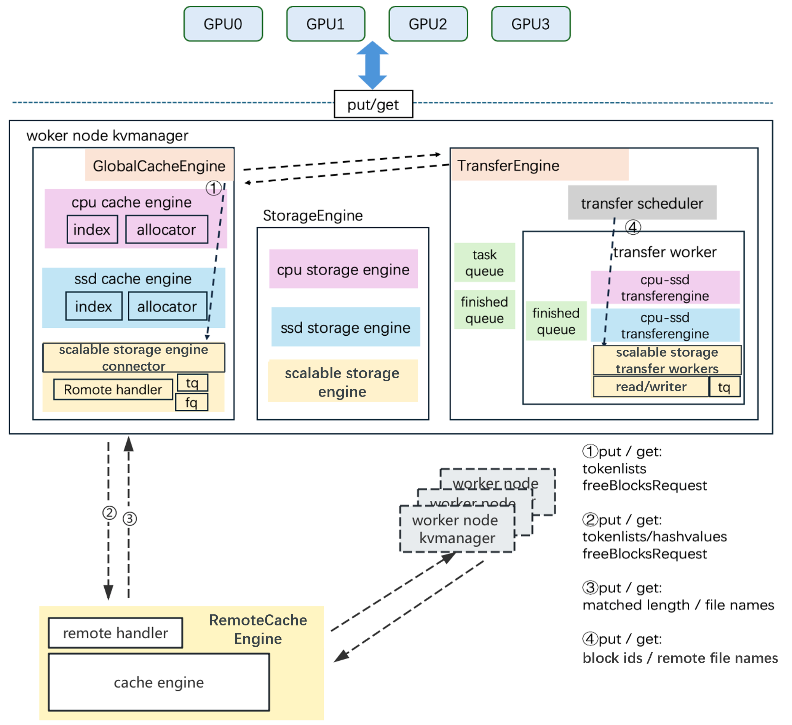

# FlexKV: 面向高性能分布式推理的KVCache Manager

**English Version**: [README.md](README.md)

FlexKV是腾讯云TACO团队和社区合作开发推出的面向超大规模 LLM 推理场景的分布式 KV Store 与多级缓存管理系统，利用多级缓存支撑推理引擎以获取更大吞吐及更低延迟。

FlexKV 采用 **Apache-2.0 开源协议**，详细信息请参见 [LICENSE](LICENSE) 文件。

## Updates

- **2026 年 10 月 9 日**：FlexKV 完成 DeepSeek-V4.1 适配（[#303](https://github.com/taco-project/FlexKV/pull/303)），已合入 `main`。配套 SGLang 适配尚未合入官方主干；在 [sglang#31781](https://github.com/sgl-project/sglang/pull/31781) 合入前，请拉取该 PR 并使用集成说明中固定的 commit。部署使用当前 FlexKV `main`。详见 [SGLang 集成说明](flexkv/integration/sglang/README_zh.md)。

- **2026 年 7–8 月**：传输性能与可运维性全面增强，包括 [GPU↔CPU 自适应多路径传输](https://github.com/taco-project/FlexKV/pull/203)、[可靠性与运行日志增强](https://github.com/taco-project/FlexKV/pull/233)、[优雅退出](https://github.com/taco-project/FlexKV/pull/238)、[分块注册 Host Memory](https://github.com/taco-project/FlexKV/pull/240)、[SSD 向量化 I/O](https://github.com/taco-project/FlexKV/pull/242) 和 [Op 级传输 Trace](https://github.com/taco-project/FlexKV/pull/247)。

- **2026 年 7 月 24 日**：支持将 [Mooncake Store](https://github.com/kvcache-ai/Mooncake) 作为基于 Key 的远端缓存层（[#231](https://github.com/taco-project/FlexKV/pull/231)），通过零拷贝 RDMA 实现集群级 KV 复用，并支持 DeepSeek-V4 的 SWA/state sidecar。

- **2026 年 7 月 21 日**：FlexKV 完成 DeepSeek-V4 适配（[#225](https://github.com/taco-project/FlexKV/pull/225)），支持异构 C4/C128/indexer KV group、FullKV + SWA 双缓存、attention/indexer compress-state sidecar 以及逐层恢复。详见 [SGLang 集成说明](flexkv/integration/sglang/README.md)和 [DeepSeek-V4 设计文档](docs/dsv4_compress_state_io_zh.md)。

- **2026 年 7 月 7 日**：🎉 FlexKV Connector 正式合入 [SGLang](https://github.com/sgl-project/sglang) 主干（[PR #29701](https://github.com/sgl-project/sglang/pull/29701)），可通过 `--enable-flexkv` 原生启用 CPU/SSD KV Cache Offloading。

- **2026 年 7 月 7 日**：新增 vLLM 在 Blackwell GPU 上的 NVFP4 KV Cache 字节级无损卸载与恢复支持（[#204](https://github.com/taco-project/FlexKV/pull/204)）。

- **2026 年 6 月 24 日**：新增 [逐层 KV 传输及 SGLang/Mooncake 集成](https://github.com/taco-project/FlexKV/commit/71dfa69)、[Pipeline Parallel 支持](https://github.com/taco-project/FlexKV/commit/1a91e7f)和 [HugePage Host Cache](docs/hugepage/README_zh.md)。

- **2026 年 3 月 17 日**：🎉 FlexKV 正式合并进入 [vLLM](https://github.com/vllm-project/vllm) 官方主干（[PR #34328](https://github.com/vllm-project/vllm/pull/34328)）！从 **vLLM v0.17.2** 起，`FlexKVConnectorV1` 已内置，**无需再手动打 patch**。详见 [docs/vllm_adapter/README_zh.md](docs/vllm_adapter/README_zh.md)。

- **2026 年 3 月 3 日**：🎉 FlexKV 正式合并进入 [NVIDIA Dynamo](https://github.com/ai-dynamo/dynamo)（[PR #5858](https://github.com/ai-dynamo/dynamo/pull/5858)）！FlexKV 成为 Dynamo 原生支持的 KV Cache Offloading 方案，实现 KV 感知路由与多级缓存卸载联合部署。详见 [docs/dynamo_integration/README_zh.md](docs/dynamo_integration/README_zh.md)。

- **2026 年 1 月 28 日**：集成 [Mooncake Transfer Engine](https://github.com/kvcache-ai/Mooncake)，FlexKV 支持基于 RDMA 的高性能跨节点 [分布式 KVCache 复用](docs/dist_reuse/README_zh.md)。

- **2026 年 1 月**：新增 TensorRT-LLM 支持（[#48](https://github.com/taco-project/FlexKV/pull/48)），vLLM 和 TRT-LLM 均支持 TP16（[#53](https://github.com/taco-project/FlexKV/pull/53)、[#59](https://github.com/taco-project/FlexKV/pull/59)）。

- **2025 年 12 月**：新增 GPU Direct Storage（GDS）支持（[#25](https://github.com/taco-project/FlexKV/pull/25)），实现 SSD 到 GPU 的直接传输，绕过 CPU。

- **2025 年 11 月**：FlexKV 从 client-server 模式升级为**可直接调用的库函数**（commit [0290841](https://github.com/taco-project/FlexKV/commit/0290841dce65ae9b036a23d733cf94e47e814934)），消除进程间通信开销，即 v1.0.0 API。

版本变更请参阅[更新日志](CHANGELOG_zh.md)。

## 如何使用

### 安装依赖

```bash
apt install liburing-dev
apt install libxxhash-dev
apt install libhiredis-dev
```

### 编译 FlexKV

```bash
./build.sh
#./build.sh --release for cython package
```

### 在 SGLang 中使用 FlexKV

参阅 [SGLang 集成指南](flexkv/integration/sglang/README_zh.md)。

### 在 vLLM 中使用 FlexKV

见[docs/vllm_adapter/README_zh.md](docs/vllm_adapter/README_zh.md)

### 在 TensorRT-LLM 中使用 Flexkv

见[docs/trtllm_adaption/README_zh.md](docs/trtllm_adaption/README_zh.md)

### FlexKV和Dynamo框架的集成

见[docs/dynamo_integration/README_zh.md](docs/dynamo_integration/README_zh.md)

### 文档导航

- [配置参考](docs/flexkv_config_reference/README_zh.md) · [命令行工具](docs/cli/README_zh.md) · [监控](docs/monitoring/README_zh.md)
- [多实例模式](docs/multi_instance/README_zh.md) · [分布式复用](docs/dist_reuse/README_zh.md) · [命名空间隔离](docs/namespace/README_zh.md)
- [驱逐策略](docs/eviction_policy/README_zh.md) · [GDS](docs/gds/README_zh.md) · [HugePage](docs/hugepage/README_zh.md) · [持续集成](docs/ci/README_zh.md) · [参与贡献](CONTRIBUTING_zh.md)

## 设计框架

<div align="center">
  
</div>

FlexKV 整体由三个核心模块构成：  
- **StorageEngine**  
- **GlobalCacheEngine**  
- **TransferEngine**

### StorageEngine

StorageEngine 根据配置初始化三级缓存，将请求中的多个 token 组合成一个 block，并以 block 为单位存储 KVCache，保持与 GPU 内部完全一致的 KV 形状（shape）。通过 block ID 计算实际存储偏移量。

此外，用户可启用 *block-wise 模式*，将多个网络层（layer）及 KV 的缓存合并为更大的 block，通过增大 I/O 单位提升传输效率。

### GlobalCacheEngine

GlobalCacheEngine 作为 FlexKV 的控制面，负责决策数据传输的方向，以及源端与目标端的 block ID。

缓存维护：
- 一个 **RadixTree**，用于前缀匹配（match/insert）
- 一个 **内存池（mempool）**，用于追踪空间使用并触发淘汰机制

当新请求到达时，GlobalCacheEngine 会比较三级存储介质中已匹配的 token 数量，并决策是否从 SSD 或 扩展存储 拉取对应 block，经由 内存 中转至 GPU。

### TransferEngine

TransferEngine 作为 FlexKV 的数据面，负责执行 GlobalCacheEngine 的传输决策。

核心特性包括：
- 多进程架构：每个进程通过多线程实现并行传输
- 支持io_uring等高性能 I/O 技术，进一步加速数据传输

### FlexKV 三级缓存

FlexKV 利用成本更低的存储介质，缓解因 GPU 显存不足而导致 KVCache 被丢弃并重新计算的问题。

三级缓存结构如下：
- **CPU 内存** —— 第一级外部缓存
- **本地 SSD** —— 第二级持久化缓存
- **扩展存储（如云存储等）** —— 第三级分布式缓存，支持更大容量与跨节点共享

FlexKV 在处理 *get* 请求时：
- 检索三级缓存，提升命中效率
- 当空间不足时，执行逻辑层面的 LRU 淘汰，无需触发实际数据传输。

#### 异步调用设计：
- *get*请求可以异步调用，*get*匹配和传输时间可以通过预取与之前的计算重合。
- *put*请求可以异步调用，从GPU copy到内存的时间可以与之后的计算重合。内存与SSD以及扩展存储间的传输则完全由TransferEngine之后执行，主进程不感知。

### 分布式 KVCache 复用

FlexKV 支持分布式 KVCache 复用，实现多节点间的高效共享。

核心特性包括：
- **分布式 RadixTree**：每个节点维护全局索引的本地快照，避免查询时的中心化瓶颈和网络往返。
- **租约机制**：保证跨节点数据传输期间的数据有效性。
- **Upload & Rebuild**：本地索引定期上传到全局元数据存储 (GMS，通常是 Redis 服务)，并通过拉取其他节点的元数据重建分布式索引。
- **Mooncake Transfer Engine**：我们使用 [Mooncake Transfer Engine](https://github.com/kvcache-ai/Mooncake) 这一基于 RDMA 的传输引擎，实现节点间高性能 KVCache 传输。

## Prometheus 监控

FlexKV 原生集成了基于 Prometheus 的运行时监控框架，覆盖 Python 和 C++ 两层关键路径。采用**零侵入**设计——只需设置环境变量 `FLEXKV_ENABLE_METRICS=1`，即可自动收集缓存命中/未命中、内存池状态、数据传输等核心指标，并通过标准 HTTP 端点暴露给 Prometheus 采集和 Grafana 可视化。

完整的指标列表、环境变量配置、监控栈（Prometheus + Grafana）部署指南，请参阅 [docs/monitoring/README_zh.md](docs/monitoring/README_zh.md)。

## 持续集成

Pull Request 和受保护分支 push 会在 GitHub Actions 中构建 release wheel，并运行 CPU
单元测试。Runner 配置、测试范围、参考耗时、本地复现步骤和产物上传规则详见
[CI 文档](docs/ci/README_zh.md)。

## 分支策略

本项目的分支管理策略如下：

- **`main` 分支**：主开发分支，包含最新的功能和变更。所有拉取请求都直接合并到 `main` 分支，以确保快速迭代和持续集成。

- **`release-*` 分支**：当 `main` 分支达到稳定状态时，我们会创建专门的发布分支（例如 `release-1.0`、`release-1.1`），为用户提供稳定、可用于生产环境的版本。

注意：在已发布版本中发现的关键修复会直接应用到对应的 `release-*` 分支，然后回退到 `main` 分支，以保持所有活跃分支的一致性。

## Roadmap

- **缓存引擎共进程化**：dev 分支将进一步优化 Cache Engine 的实现、集成和调用，并同步更新相关 API 支持
- **加速框架支持**：深化 vLLM、SGLang 和 TensorRT-LLM 原生集成，并扩展更多推理引擎支持
- **分布式查询支持**：实现可扩展的分布式 KVCache 查询能力
- **延迟优化**：通过预取、压缩等手段进一步降低 *get* 请求延迟
