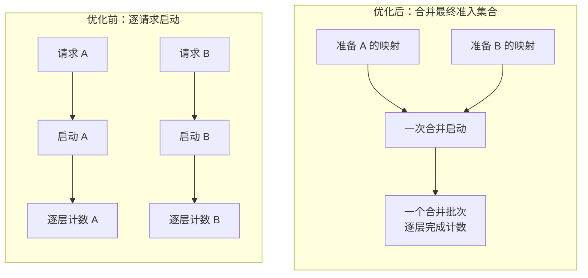
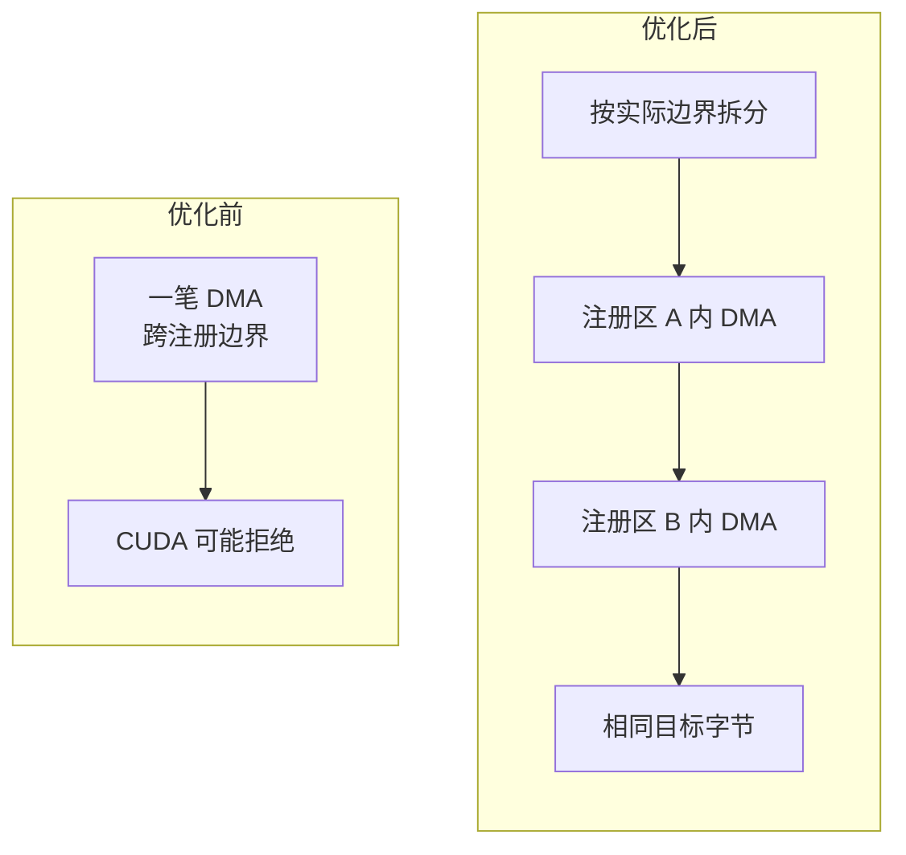
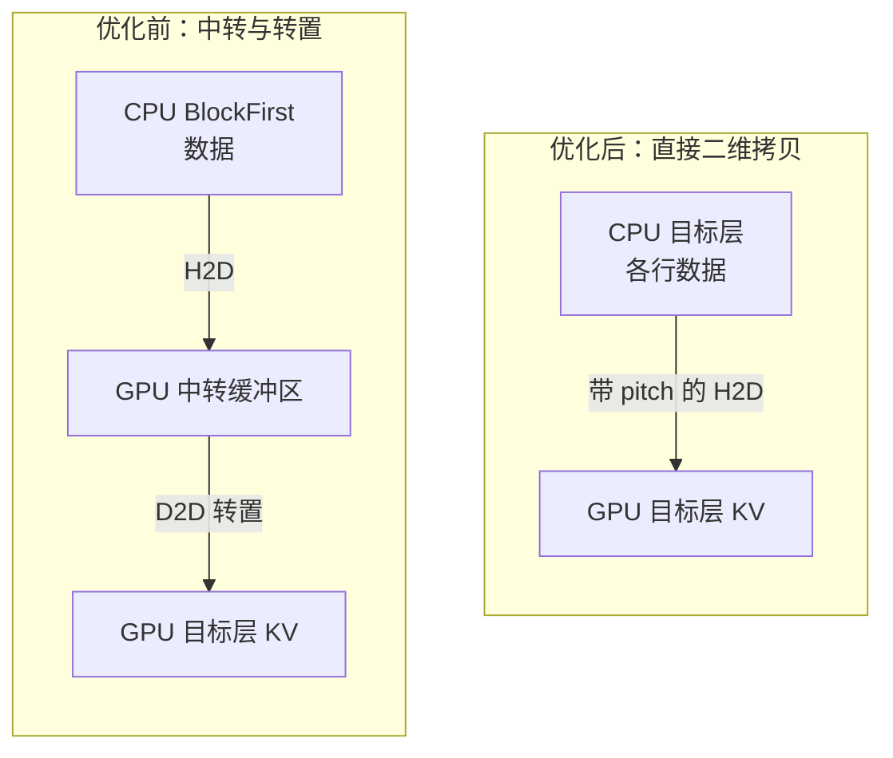
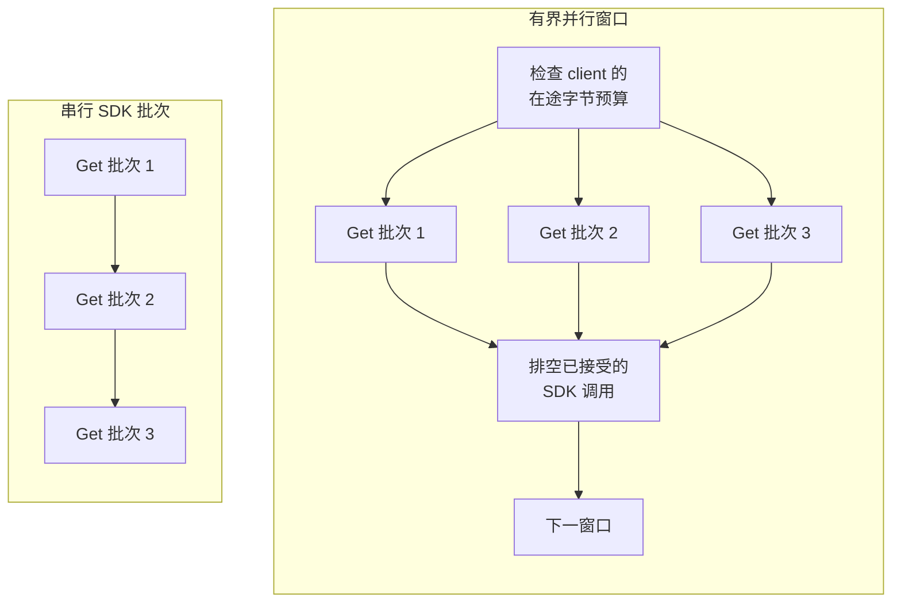
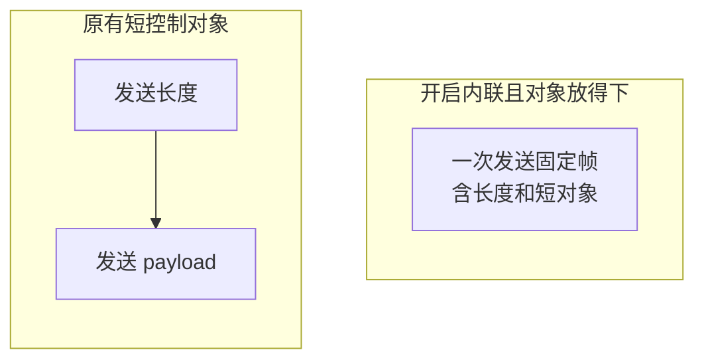
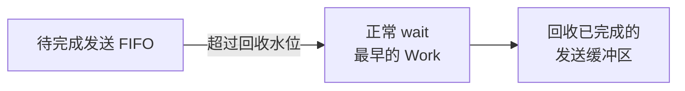
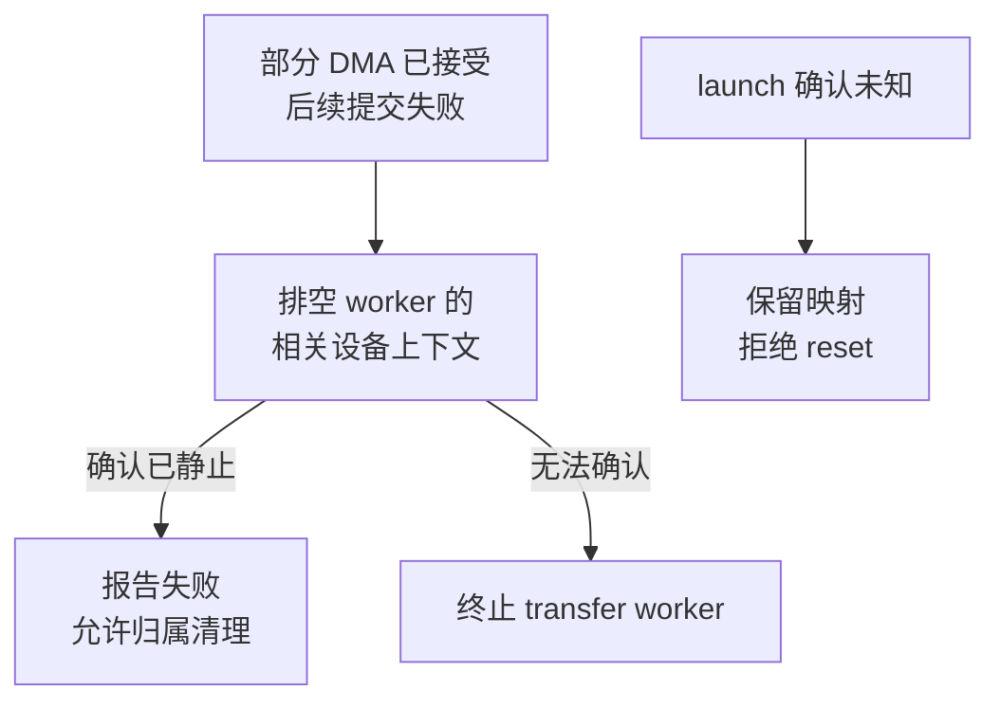

# 缓存恢复优化图解

[English guide](cache_tier_performance_controls.md)

本次复用已有的逐层传输、图合并和 CE 引擎，改进提交时机、拷贝路径及资源生命周期。
准入后合并恢复需要 [FlexKV #323](https://github.com/taco-project/FlexKV/pull/323)
和 [SGLang 配套 #17](https://github.com/XingLiu1/sglang/pull/17)。
所有图都是机制示意，箭头和节点数量不表示测得的耗时或吞吐。

| 改动 | 减少或约束什么 | 主要条件 |
| --- | --- | --- |
| 准入后合并恢复 | 最终 launch 和逐层完成信号的重复开销 | 普通 IP adapter，开启合并且 connector 支持对应 API |
| 直接二维 CE | 符合条件的 GPU 中转和 D2D 转置 | 部分 BlockFirst H2D、二维拷贝开启、连续段数受限 |
| 有界并行 Get | 重叠 SDK 等待，同时约束在途字节 | 每个 data client 的并发数、字节预算和原 SDK 批量限制 |
| 控制帧内联与 FIFO 回收 | 短对象发送次数、重复序列化和发送缓冲区保留 | 所有 rank 配置一致；内联仅支持 PP=1 |
| 注册边界与失败排空 | 保证实际完成后才允许复用缓存块 | 正确性保护，不作为独立吞吐收益 |

## 1. 先确定准入集合，再合并启动

逐请求的 lookup、映射和预检查仍然执行。`defer_launch=True` 只准备目的槽位和完成计数，
不提交 DMA。scheduler 确定 `can_run_list` 后，在 forward setup 前调用一次
`flush_layerwise_loads`，复用已有的图合并能力统一提交。

这样可以减少最终启动和完成通知的重复工作，forward 仍要等待对应层的 H2D 完成。
它不会因为请求已准入就提前消费未完成的 KV。请求身份保留完整的 `(rid, attempt_id)`。
完成计数按消费方核算：各 rank 仍有自己的逐层等待和通知，等待对象改为一个合并任务。

`FLEXKV_BATCH_LAYERWISE_RESTORE=1` 默认关闭，且需要
`FLEXKV_ENABLE_LAYERWISE_TRANSFER=1`。普通 IP adapter 支持该路径；MP、hybrid
以及缺少合并 API 的旧 connector 保留原启动方式。

## 2. CE：先保证能正确拷贝，再减少额外搬运

### 按真实注册边界拆分 DMA

相邻的虚拟地址可能属于两次独立的 `cudaHostRegister`，一笔 DMA 跨越它们时可能失败。
新实现记录实际 base、size、chunk，按边界拆分一维或二维拷贝；一行跨边界时继续拆行，
同一注册区内的连续行仍保留一次二维拷贝。注销使用最初登记的分块大小。
拆分后的子拷贝继续在原 stream 上按顺序提交。

这是分块注册与 CE 配合工作的正确性前提。更新后必须重编译 native extension；旧扩展
会在启用“分块注册 + CE”时明确要求重编译。

### 部分 BlockFirst H2D 直接拷贝到目标层

CPU 的不同层交错在各个 block 中。二维拷贝的 width 覆盖当前层的数据，source pitch
跳到下一个 CPU block，从而直接落到目标 GPU 层，省去中转和转置。逻辑 KV 数据量不变。

该分支要求部分 BlockFirst H2D、二维拷贝开启且连续段数不超过阈值。整块恢复、D2H、
过于碎片化或禁用二维拷贝的情况保留已有路径。
`FLEXKV_USE_CE_TRANSFER_H2D`、`FLEXKV_USE_CE_TRANSFER_D2H` 默认均为 `0`；
路径优化和二维拷贝开关 `FLEXKV_CE_PATH_OPT`、`FLEXKV_ENABLE_CE_MEMCPY2D` 默认均为 `1`。

## 3. 远端 Get 并行，但保留预算和排空边界

三个批次仅用于示意等待重叠。`FLEXKV_MOONCAKE_GET_CONCURRENCY` 默认 `1`，允许
1–8；query-only client 保持串行。并发读取受每个 data client 的 padded-byte 总预算
约束，原有 `max_get_batch_bytes` 原始字节批量限制也继续生效。结果按原顺序返回，短读
不能记为成功，失败后也要等待已经接受的调用排空。

数据路径仍为 **Store → CPU Host Cache → GPU**。并行 Get 本身不建立 Store-to-GPU
直达路径，也不证明跨机带宽或 RDMA 压力改善。

协调器的 `max_reserved_bytes`、`max_sessions`、数据 I/O 会话数，与 SDK 的在途字节预算
是不同限制。其他请求暂时持有信用时保留等待；没有在途 I/O 持有信用时才采用永久容量
不足的回退。取消请求也要排空已提交图，才能归还数据 I/O 会话槽位；CPU 结果租约另行保留。

## 4. 少发短控制消息，安全回收发送缓冲区

同一轮 fan-out 只序列化一次，多个目的 rank 共用不可变发送缓冲区。小控制对象放进
固定帧可减少 send 调用；更大的对象回退到 header + payload。固定帧的填充可能增加
实际发送字节，因此该优化针对调用和序列化开销。KV 本体仍走独立的数据路径。

`FLEXKV_CONTROL_INLINE_BYTES=0` 保持原协议；开启时所有 rank 必须一致，且仅支持 PP=1。

FIFO 回收同时适用于传统帧和内联帧，用正常 `Work.wait()` 推进完成并保留缓冲区生命周期，
避免用短 timeout 探测而中止共享 Gloo transport。

## 5. 失败先确认排空，再允许资源清理

排空范围覆盖相关 rank，也覆盖此前分组在同一 transfer worker 设备上下文中提交的工作。
无法确认静止时，不能报告一个可正常回收缓存块的失败结果。

分配失败发生在启动之前：各 rank 先投票，成功的 peer 释放新分配槽位，取消 held lookup，
已有的可复用 GPU 前缀仍归缓存所有。launch 确认状态未知时则保留映射、拒绝 reset。
这些改动提供完成和生命周期保护，不代表自动请求恢复或独立的稳定态吞吐提升。

## 从哪里读代码、验证什么

| 路径 | 代码入口 | 相关验证 |
| --- | --- | --- |
| 准入后合并 | [`connector.py`](../flexkv/integration/sglang/connector.py) 的 prepare/flush，配套 SGLang scheduler hook | [`test_sglang_layerwise_batch.py`](../tests/test_sglang_layerwise_batch.py)，SGLang CPU/mock 准入与回收测试 |
| CE 拷贝 | [`host_dma.h`](../csrc/host_dma.h)、[`ce_transfer.cu`](../csrc/ce_transfer.cu) | CPU 分区规划器与 metadata 测试；[`CUDA 字节与逐层完成测试`](../tests/test_ce_chunked_registration_cuda.py) |
| 并行 Get 与会话预算 | [`mooncake_store_utils.py`](../flexkv/external/mooncake_store_utils.py)、[`coordinator.py`](../flexkv/prefetch/coordinator.py) | 受控 SDK 调用、信用等待、取消与 shutdown 排空测试 |
| 控制通信 | [`comm.py`](../flexkv/integration/sglang/comm.py) | CPU/mock 回归及真实四 rank Gloo 内容比较 |
| 失败排空 | [`device_thread_pool.cpp`](../csrc/device_thread_pool.cpp) | [`CPU 模拟 CUDA 故障注入`](../tests/test_host_dma_failure_drain.py)，不等同于真实设备故障恢复验收 |

配置默认值、预算公式和复现命令见 [English guide](cache_tier_performance_controls.md)。
传输字节、CPU/mock 生命周期、模型输出一致性、跨机性能和持续容量分别验证。
