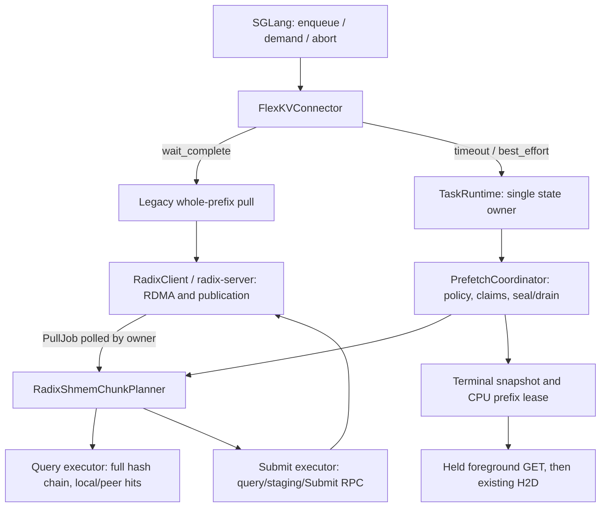

# RadixShmem Prefetch Design

FlexKV supports `wait_complete`, `timeout`, and `best_effort` over the RadixShmem
CPU cache. Policy and resource ownership stay in FlexKV; RadixShmem discovers,
transfers, and publishes peer KV. Chunking creates boundaries at which FlexKV can
stop admitting work without cancelling an active RDMA transfer.

This document covers the Full-KV path. RadixShmem chunked prefetch does not restore
SWA checkpoints; unsupported SWA sessions fail capability checks at startup.
Use the legacy `wait_complete` path for SWA. Server deployment, geometry, and
storage sizing are described in the [configuration guide](../radixshmem/config_en.md).

## 1. Policy routing and stopping

| Policy | SGLang route | Stop condition | Result availability |
| --- | --- | --- | --- |
| `wait_complete` | Original whole-prefix `prefetch_async` / `pull_async` | Whole pull finishes or fails | After the pull completes |
| `timeout` | Chunked session | Session budget expires | After all claimed chunks drain |
| `best_effort` | Chunked session | Scheduler sends demand when considering admission | After all claimed chunks drain |

Chunking is opt-in. When disabled, SGLang uses the original path regardless of
the policy setting. When enabled, an explicit FlexKV policy takes precedence
over SGLang's `hicache_storage_prefetch_policy`; `wait_complete` disables the
chunk runtime before KVManager creation. Direct session API callers can still
use `wait_complete` with the coordinator. An external KVServer must be started
with its own matching configuration.

The timeout clock starts at session creation, including metadata work. It limits
**new chunk admission**, not total request latency. Demand also does not mean
immediate return. Work claimed before stopping must finish; the returned prefix
may include data published during drain. If all work was claimed before the
deadline, the stop reason can remain `complete` even when drain finishes later.
Capacity limits or read failures can produce partial or empty results under any
policy.

## 2. Architecture



`TaskRuntime` serializes task/session mutations and completion handling. Separate
single-worker query and submission executors keep metadata lookup, staging, and
Submit RPC waits off that owner thread. The owner polls futures and PullJobs,
including synchronously completed jobs. Calls are not forcibly preempted.

RadixShmem peer data bypasses the Mooncake REMOTE2H graph/worker path. Empty graph
IDs identify claims in the shared coordinator; PullJob completion is adapted to
its existing completion contract. Foreground CPU-to-GPU transfers remain on the
existing H2D path. The legacy prefetch planner returns an empty plan when chunked
mode owns peer pulls, preventing duplicate whole-prefix submissions.

| Responsibility | Implementation |
| --- | --- |
| Shared planner contract | [base_planner.py](../../flexkv/prefetch/base_planner.py) |
| Peer discovery, chunk claims, completion and pins | [radixshmem_planner.py](../../flexkv/prefetch/radixshmem_planner.py) |
| Policy, admission, drain and leases | [coordinator.py](../../flexkv/prefetch/coordinator.py), [policy.py](../../flexkv/prefetch/policy.py), [types.py](../../flexkv/prefetch/types.py) |
| Owner thread and backend selection | [runtime.py](../../flexkv/prefetch/runtime.py), [kvtask.py](../../flexkv/kvtask.py) |
| Pull wrapper and legacy-path suppression | [radix_shmem_engine.py](../../flexkv/cache/radix_shmem_engine.py), [radix_shmem_planner.py](../../flexkv/cache/radix_shmem_planner.py) |
| Scheduler integration and timeout configuration | [connector.py](../../flexkv/integration/sglang/connector.py), [shm_radix_bootstrap.py](../../flexkv/server/shm_radix_bootstrap.py) |

## 3. Prefix planning and chunk execution

1. **Discover:** Hash the full token chain once and probe local/cluster prefixes
   asynchronously. On resolution, rematch and retain the actual local prefix;
   an earlier metadata hit does not establish a residency lease.
2. **Reserve:** Bound the next chunk by `chunk_max_blocks`, remaining prefix,
   and reserved/pinned byte budgets. Register its claim before submission and
   recheck the policy deadline before admitting it.
3. **Submit:** Pass the complete hashes with `start=0, end=block_end` to
   `pull_async`. RadixShmem discovers against the full path and clips staging to
   that end. Already-local blocks are reused; only the missing suffix is moved.
4. **Complete:** Poll the submission future and PullJob, consume `wait(0)`
   exactly once, and finalize the result. For this root-based job,
   `common_hit` is an absolute block count; clamp it to the chunk span.
5. **Commit:** Advance only the contiguous published prefix and retain its match.
   A partial chunk closes further extension; no later result can bridge a gap.
   Return reservation credit only after commit/discard.
6. **Handoff:** Once sealed with no outstanding claims, publish the terminal
   snapshot. Foreground GET acquires its own CPU reference before releasing the
   session lease, then uses existing H2D and computes the remaining tail.

A RadixShmem query walks from the radix root. Slicing `hashes[begin:end]` would
create a different path. Discovering with only `hashes[:end]` can also miss a
remote prefix registered at a coarser RHT granularity. Full-path discovery plus
bounded staging handles both cases.

The planner currently permits **one claimed chunk globally per planner**, including
work not yet submitted. Overlapping growing-prefix pulls could otherwise race on
the same path. `PrefetchBusy` means retry, not a capacity stop. The coordinator
releases completed claims before admission and rotates successfully admitted
sessions. Raising `max_inflight_chunks` alone does not lift this global guard.

## 4. Session lifecycle and resource ownership

The planner contract is
`begin → resolve → reserve → submit_batch → poll_completions/complete → commit/discard → release`.
Sessions progress through `planning → active → draining → terminal`; phases can
be skipped when no work is outstanding.

**Seal freezes admission; drain ends ownership of submitted work.** A claim in a
submission executor is already outstanding even if RDMA has not started.
Terminal delivery requires `submitted_chunks == sealed_submit_seq`,
`inflight_chunks == 0`, `inflight_bytes == 0`, and completed publication.

| Resource | Ownership and release |
| --- | --- |
| Chunk reservation | Retained from admission until commit/discard; budget also allows for staging to become pinned |
| CPU prefix lease | Holds an actual radix match; released after foreground handoff, explicit release, or terminal-result TTL |
| Session admission slot | Includes retained terminal results; returned on retirement |
| Transport slots, source pins, outstanding credit | Owned by RadixShmem until safe completion; retained on uncertain outcomes |

Pin accounting conservatively includes compressed-node tails beyond the requested
boundary. These byte limits share the existing CPU pool; they are not additional
memory allocations. Shared-prefix leases may be charged conservatively.

The manager API exposes `start_prefetch`, `progress_prefetch`,
`poll_prefetch`, `wait_prefetch`, `notify_prefetch_demand`, `stop_prefetch`,
and `release_prefetch`. Pass the full token chain; `candidate_start_token` only
changes the candidate length used in budget calculation. Snapshots distinguish
planned hits, the leased reusable endpoint, and actually loaded `l3_loaded_spans`.

Poll/wait do not send demand. A caller-side wait timeout does not stop the session.
Release is idempotent; releasing an active session seals it but retains claims
until drain. Active sessions do not expire. Unreleased terminal leases expire
after `prefetch_result_ttl_s`; bounded tombstones carry no residency guarantee.
Abort may leave successfully cached data; reset/shutdown discard unpublished
work and cannot clear/reuse buffers while transfers remain active.

## 5. Deadlines and uncertain transfers

Two deadlines are independent: the **policy budget** stops admission, while
`chunk_timeout_ms` is the server deadline for one pull. Neither forcibly cancels
RDMA or bounds request latency.

The companion RadixShmem implementation must keep expired `PENDING` transfers
and handles returning `EBUSY` owned until the transport is quiescent. Only then
can it report failure and safely reclaim unpublished slots. Known rejections
such as busy/unavailable may return local hits. Temporary WaitAny RPC failures
retain jobs and retry; a continuous 30s outage, plus the current RPC wait, raises
and quarantines resources. Ambiguous Submit outcomes and unknown tickets also
quarantine destination slots, source pins, and outstanding credit until process
teardown. `close()` refuses undrained/quarantined clients.

FlexKV propagates submission/completion errors in session results and fails on
uncertain publication ownership. Such errors must not be reported as successful
cache misses. Shutdown has a 30s control drain guard; exceeding it retains
registered buffers. Recovery must establish that the old data plane is quiescent
before rebuilding its processes/regions.

## 6. Configuration and integration

Start compatible RadixShmem servers first or allow them to become ready during
FlexKV startup. Keep CPU-only RadixShmem configuration: disable SSD, remote-store,
and P2P tiers; cross-node cache reuse is supplied by RadixShmem itself. Mooncake
store and RadixShmem backend selection are mutually exclusive.

Set before importing FlexKV; this fragment assumes existing server configuration:

```bash
export FLEXKV_ENABLE_RADIXSHMEM=1
export FLEXKV_CPU_LAYOUT=BLOCKFIRST
export FLEXKV_ENABLE_CHUNKED_PREFETCH=1
export FLEXKV_PREFETCH_OPTIONS='{"policy":"timeout","timeout_budget_s":3.0,"chunk_max_blocks":4,"max_inflight_chunks":1,"chunk_timeout_ms":5000}'
```

With `tokens_per_block=256`, four blocks mean at most 1024 tokens per chunk;
tail chunks and resource limits may reduce that size. Transfer chunk size is
independent of SGLang prefill chunk size. Use `policy=best_effort` for demand
stopping, or `wait_complete` for SGLang's legacy route.

| Setting | Default / precedence |
| --- | --- |
| `chunk_max_blocks` / `max_inflight_chunks` | 128 blocks / 2 per session; the global serial guard still applies |
| `timeout_budget_s` | Explicit override; otherwise `min(timeout_max_s, timeout_base_s + timeout_per_ki_token_s × candidate_tokens / 1024)`, defaults 30 / 2 / 0.1 |
| `prefetch_max_sessions` | 128 per coordinator, including retained result leases |
| `prefetch_max_reserved_bytes` / `prefetch_max_pinned_bytes` | 512 MiB / 2 GiB per coordinator/planner |
| `prefetch_result_ttl_s` | 60 seconds, terminal leases only |
| `chunk_timeout_ms` | Option overrides `FLEXKV_RADIXSHMEM_CHUNK_TIMEOUT_MS`, then 5000 ms default |
| `FLEXKV_PREFETCH_DATA_CONCURRENCY` | 0: no extra data-session cap; does not override planner serialization |

JSON configuration uses `enable_chunked_prefetch` and `prefetch_options` and takes
precedence over environment-backed UserConfig values. Standalone servers must
receive the matching settings; clients do not reconfigure running runtimes.

SGLang requires enqueue/demand/abort and lease-handoff hooks. The sync leader
starts/progresses sessions and distributes the same snapshots or errors to other
ranks. Nonterminal requests remain waiting. After terminal, foreground lookup
is CPU-only so it cannot silently undo the stop decision with another peer pull.
CPU-ready is distinct from H2D completion and model readiness. Use compatible,
isolated model/weight/dtype/TP/layout pools; direct API namespaces do not replace
consistent foreground namespace propagation.

## 7. Observability and validation

Terminal logs (`flexkv.prefetch.coordinator`, INFO) report policy, reason, submitted
and sealed counts, loaded tokens, elapsed/drain milliseconds, and error.
Snapshots expose per-session claims, bytes, spans, and lease validity.
With `FLEXKV_ENABLE_METRICS=1`, the current collector records
`flexkv_prefetch_sessions_total`, `flexkv_prefetch_loaded_tokens_total`,
`flexkv_prefetch_elapsed_seconds`, and `flexkv_prefetch_drain_seconds`.
These terminal metrics do not replace active reserved/pinned ledger inspection
or physical peer-transfer byte counters.

| Coverage | Tests |
| --- | --- |
| Policy, fairness, deadline/demand, drain and leases | [test_coordinator.py](../../tests/prefetch/test_coordinator.py), [test_runtime.py](../../tests/prefetch/test_runtime.py) |
| RadixShmem claims, asynchronous submission, pinning and errors | [test_radix_shmem_chunk_planner.py](../../tests/prefetch/test_radix_shmem_chunk_planner.py) |
| Legacy suppression and bounded pulls | [test_radix_shmem_engine.py](../../tests/radixshmem/test_radix_shmem_engine.py) |
| Connector routing, rank agreement and metrics | [test_integration_native.py](../../tests/prefetch/test_integration_native.py), [test_prefetch_metrics.py](../../tests/prefetch/test_prefetch_metrics.py) |

Run lightweight control tests without native/CUDA dependencies:

```bash
python -m pytest --confcutdir=tests/prefetch \
  tests/prefetch/test_coordinator.py tests/prefetch/test_runtime.py -q
```

Native/integration tests require matching FlexKV and RadixShmem extensions and
runtime libraries. RadixShmem's own `test_pull_job_progress.py` and
`test_server_rpc.py` cover range progress and safe drain/failure handling.
For two-node acceptance, verify physical peer bytes, returned KV bytes through
H2D, no submissions after seal, terminal/retirement counts, and zero residual
jobs/reservations/pins after release. Known-answer probes and random long-prompt
output equivalence are separate checks; the latter remains unresolved in the
recorded benchmark runs. Compare identical payloads, routing, concurrency, and
cache states before attributing TTFT changes to a policy or chunk size.
