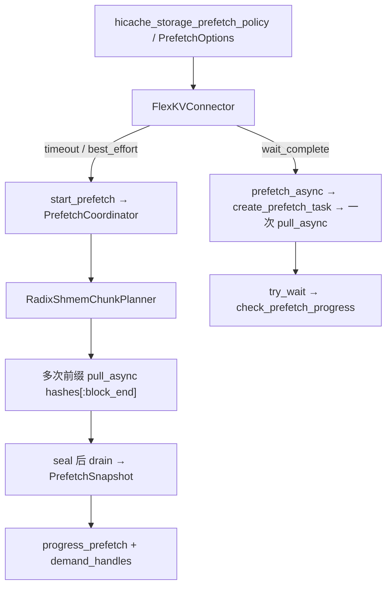

# Radixshmem 分段预取与三策略适配

**在 FlexKV + radixshmem（跨节点 peer pull）路径上对齐 Mooncake 的三种 prefetch 策略：`wait_complete`、`timeout`、`best_effort`。**

Mooncake 分段预取的通用行为与 seal/drain 语义见 [chunked_prefetch.md](./chunked_prefetch.md)。本文只描述 **radixshmem 后端** 的差异、设计决策与已落地实现映射。运维配置见 [radixshmem/config_zh.md](../radixshmem/config_zh.md)。

## 1. 背景与差距

| 路径 | 策略作用点 | 行为 |
|------|------------|------|
| Mooncake + chunked | `flexkv/prefetch/policy.py` + `coordinator.py` | 分段 REMOTE2H；`timeout` 按 budget seal；`best_effort` 在 demand 时 seal；seal 后 drain inflight |
| Mooncake + wait_complete | connector 关闭 chunked | 整任务 `prefetch_async` |
| **Radixshmem 改造前** | 固定 `PREFETCH_TIMEOUT_MS=5000` | 入队即一次 `pull_async`；`check_prefetch_progress` 等 `try_wait` → **实质只有 wait_complete** |
| Chunked 门禁（改造前） | `KVTaskEngine.__init__` | 强制 `use_mooncake_store_backend`，radixshmem 无法启用分段 |

根因：单次 `pull_async` 在 plan 时已提交整段 RDMA；若不拆段，`best_effort` 的 first-poll seal+drain 会退化成「等这一次整段 pull 结束」。要与 Mooncake 语义对齐，必须 **分段下发 peer pull**。

## 2. 设计决策

1. **复用**现有 `PrefetchCoordinator` / `PrefetchOptions` / CLI `hicache_storage_prefetch_policy`，不新建第二套策略名。
2. **`wait_complete`**：与 Mooncake 一致——关闭 chunked，走现有整段 `pull_async` 路径（connector 在创建 KVManager 前关掉分段运行时）。
3. **`timeout` / `best_effort`**：启用 chunked runtime，backend 为 `RadixShmemChunkPlanner`（不是 `MooncakeChunkPlanner`）。
4. **radixshmem 库**：不做 C++ 层 policy 枚举；只补 Python 侧进度与区间参数，策略语义留在 FlexKV。

## 3. 架构



SGLang scheduler 门控不变：仍轮询 `check_prefetch_progress` / `pop_prefetch_loaded_span`；未 terminal 则请求留在 waiting queue。

## 4. 策略语义（radixshmem）

| 策略 | 停止下发新 chunk | 交付时机 | 结果 |
|------|------------------|----------|------|
| `wait_complete` | 不分段；整段 pull 完成 | `PullJob.done()` | 尽量拉满 `[local_hit, planned_hit)` |
| `timeout` | `now >= start + budget(tokens)` | seal 后 drain 已提交的 `pull_async` | 预算内已 publish 的连续前缀 |
| `best_effort` | scheduler 首次 `progress_prefetch(..., demand_handles=)` | seal 后 drain inflight | 排队期已加载的前缀；立即调度可能接近 0 |

三者都要等已下发工作完成后再交付（seal ≠ terminal）。

**两层超时解耦：**

- **策略层** `PrefetchOptions.budget()`：决定还能否 claim 新 chunk。
- **传输层** `PREFETCH_TIMEOUT_MS` / `FLEXKV_RADIXSHMEM_CHUNK_TIMEOUT_MS` / `prefetch_options.chunk_timeout_ms`：单次 `pull_async` 的服务端 job deadline；到期后该次 job 以本地命中部分完成。

## 5. 前缀分段约束

Mooncake REMOTE2H 按 block hash 内容寻址，任意子区间可独立拉取。radixshmem 的 index query 是 **从根出发的前缀路径**：

- 每个 chunk 必须 `pull_async(hashes[:block_end])`（绝对前缀到 chunk 终点），不能切 `hashes[begin:end]` 作为独立路径。
- 本地已命中 `[0, begin)` 时，transfer 只搬远端后缀；`common_hit` 仍为相对 radix 根的绝对块数。
- 同前缀的并发 pull 会竞态，因此 `RadixShmemChunkPlanner` **串行 inflight**（有未完成 chunk 时 `reserve` 返回 `None`）。

## 6. 关键实现映射

| 职责 | 路径 |
|------|------|
| Planner 薄基类 / 契约 | `flexkv/prefetch/base_planner.py`（`ChunkPlannerBase`） |
| 分段 backend | `flexkv/prefetch/radixshmem_planner.py`（`RadixShmemChunkPlanner`） |
| 策略 / seal / drain | `flexkv/prefetch/coordinator.py`（`poll_completions` 轮询 PullJob） |
| 策略回调 | `flexkv/prefetch/policy.py` |
| 选项与 snapshot | `flexkv/prefetch/types.py`（`PrefetchOptions.from_mapping` 忽略 backend-only 键如 `chunk_timeout_ms`） |
| 后端分发与门禁 | `flexkv/kvtask.py`（Mooncake ↔ radixshmem 互斥） |
| Legacy 整段 plan | `flexkv/cache/radix_shmem_planner.py`（`enable_chunked_prefetch` 时 `_plan_prefetch` 返回空） |
| `pull_async` 包装 | `flexkv/cache/radix_shmem_engine.py`（`hash_start` / `hash_end`） |
| 传输超时配置 | `flexkv/server/shm_radix_bootstrap.py`（`chunk_transfer_timeout_ms`） |
| SGLang 接线 | `flexkv/integration/sglang/connector.py`（policy 默认注入；SWA + radix chunked 启动 Fail-fast） |
| PullJob 进度 | `radixshmem/python/radixshmem/client.py`（`published_hit`、`pull_async(..., start=, end=)`） |

### Backend 接口（对齐 MooncakeChunkPlanner）

`begin` → `resolve` → `reserve` → `submit_batch` → `poll_completions` / `complete` → `commit` / `discard` → `release`。

- `submit_batch`：对每个 chunk 启动前缀 `pull_async`（无 TE graph）。
- `poll_completions`：把已完成的 `PullJob` 转成 coordinator 可消费的假 completion（`op_id=-1`）。
- `commit`：按 `common_hit` 推进连续前缀并刷新 pin lease。

分段路径当前为 **Full-KV**。`prefetch_capabilities().partial_swa_checkpoints` 在 radixshmem 后端为 `False`；带 paged SWA 的模型若开启 chunked，connector 在启动能力检查处 **Fail-fast**（勿静默只拉 Full）。SWA 请用 legacy `wait_complete`。

## 7. 配置示例

```bash
export FLEXKV_ENABLE_RADIXSHMEM=1
export FLEXKV_ENABLE_CHUNKED_PREFETCH=1
export FLEXKV_PREFETCH_OPTIONS='{"policy":"timeout","chunk_max_blocks":64,"timeout_base_s":2.0}'
# 或依赖 SGLang: --hicache-storage-prefetch-policy best_effort

# 可选：单 chunk RDMA 硬超时（毫秒）
export FLEXKV_RADIXSHMEM_CHUNK_TIMEOUT_MS=5000
```

`policy=wait_complete` 时 connector 自动关闭 chunked → 行为与改造前整段 pull 一致。

## 8. 明确不做

- 不把三段策略下沉到 radixshmem C++ / `ITransferBackend`。
- 不复用 Unified HiCache 的 `_can_terminate_prefetch`（FlexKV 路径不走 UnifiedRadixCache）。
- 不在单次 RDMA batch 内做 slot 级部分成功（部分前缀靠多个已完成 chunk 累积）。
- 不分段路径上的 SWA checkpoint（与 Mooncake chunked 的 `swa_aware` 对齐前保持 legacy；SWA 模型 + radix chunked 启动拒绝）。

## 9. 测试锚点

| 层级 | 位置 |
|------|------|
| Coordinator + 假 radix backend | `FlexKV/tests/prefetch/test_radix_shmem_chunk_planner.py` |
| 既有策略回归 | `FlexKV/tests/prefetch/test_coordinator.py` |
| Legacy / chunked 跳过整段 pull | `FlexKV/tests/radixshmem/test_radix_shmem_engine.py` |
| PullJob 进度 API | `radixshmem/python/tests/test_pull_job_progress.py` |

## 10. 相关文档

- [FlexKV 分段预取（Mooncake）](./chunked_prefetch.md)
- [分段预取开发参考](./chunked_prefetch_reference.md)
- [radixshmem 模式配置](../radixshmem/config_zh.md)
- [两机部署：SGLang + FlexKV + radixshmem + NIXL](../radixshmem/deploy_2node_nixl_zh.md)
