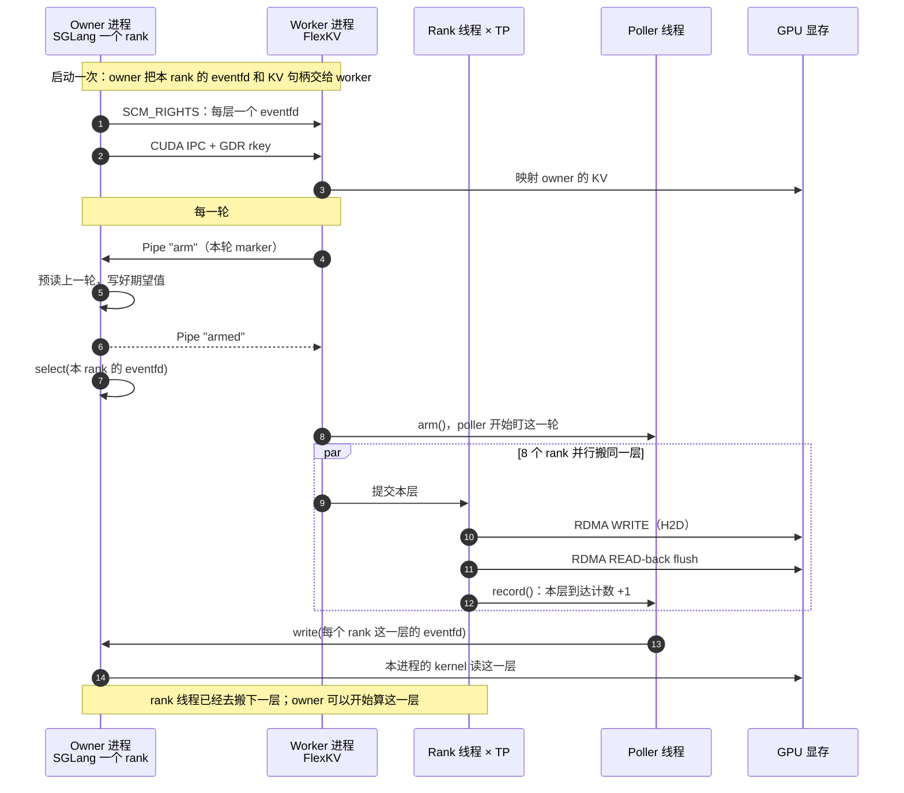

# 在一些特殊机型和场景下的编译、sglang 调用、benchmark 脚本

## 编译

先激活已经配置好 `torch_xmlir`、XRE/XDR 和 OFED 的 Python for some special machine types and scenarios 环境。下述
`python` 和测试脚本使用的 `python3` 应指向同一环境。编译还需要 C/C++ 编译器、
CMake、Python 构建依赖，以及 libibverbs、liburing 的开发头文件和库；
`--no-deps --no-build-isolation` 不会自动安装这些依赖。

### 独立 一些特殊机型和场景 XDR 预检与性能测试

可先用独立的 一些特殊机型和场景 XDR 测试确认设备内存能够注册并进行 RDMA （不需要编译 FlexKV）：

# 先在 host 上：

modprobe kunlun
modprobe kunlun-peermem

```bash
# 从 FlexKV 根目录进入；所需源码和辅助脚本已包含在此目录。
cd /path/to/FlexKV/tests/gdr/gdr_perf

# 显式指定经 PCI 拓扑确认的设备/NIC 配对，不能假定编号相同。
# 下列配对适用于此前验证过的机器；其他机器需重新确认。
export GPU_ID=0
export RDMA_DEV=mlx5_bond_3
bash test_gdr_loopback.sh        # WRITE + READ，校验 payload
bash test_gdr_loopback.sh write
bash test_gdr_loopback.sh read
SIZE=8388608 ITERS=1000 bash test_gdr_loopback.sh   # 多轮测试，可测不同 QP 数下的读写性能

# 测试 RDMA 网卡支持的 outstanding read 深度
bash check_rdma_read_limit.sh
```

预检不依赖 NVIDIA perftest，也不依赖目录外的 `special-platform validation suite` 文件，但仍需要机器上
安装好的 XRE/XMLIR、OFED/libibverbs 开发库，以及 `cc`、Python 3 等工具；
网卡统计还使用 `ip`、`ethtool`。这套独立预检的默认 NIC 选择不是 FlexKV 的
PCI 拓扑自动探测，因此应显式指定已确认的 `GPU_ID` / `RDMA_DEV` 配对。

`tests/gdr/gdr_perf/` 已包含 `special-platform validation suite` 的全部 9 个源码/脚本文件，
其中 `_common.sh`、`test_xdr.c` 为公共实现，测试入口如下：


| 入口                          | 覆盖内容                                  |
| --------------------------- | ------------------------------------- |
| `test_gdr_loopback.sh [both | write                                 |
| `check_rdma_read_limit.sh`  | 查询网卡 outstanding READ/ATOMIC 能力       |
| `test_roce_loopback.sh`     | Host→Host RDMA WRITE 基线，隔离 XDR/显存路径因素 |
| `test_xdr_torch.sh [both    | write                                 |
| `bench_gdr_loopback.sh`     | H2D WRITE 的消息大小 × QP × 队列深度扫描，输出 CSV  |
| `bench_gdr_read.sh`         | D2H READ 的消息大小 × QP × 队列深度扫描，输出 CSV   |


以下命令在同一 `gdr_perf` 目录执行，沿用上方经确认的 `GPU_ID`、`RDMA_DEV`：

```bash
# Host DRAM 基线：不访问 XPU 显存。
SIZE=8388608 ITERS=1000 QPS="1 2 4" bash test_roce_loopback.sh

# 更接近 FlexKV 的 Torch 分配场景；需要当前环境中的 torch/XMLIR 和 numpy。
# 自动编译 libxdr_gdr.so，然后运行同目录 test_xdr_torch.py；无需安装 FlexKV。
SIZE=8388608 ITERS=100 QPS="1 2 4" bash test_xdr_torch.sh

# 紧凑扫描：分别输出 WRITE 和 READ 的 CSV 及每个参数组合的日志。
SIZE_LIST="65536 1048576 8388608" QP_LIST="1 2 4" \
TX_DEPTH_LIST="1 8 16" ITERS=1000 \
RESULT_DIR="results_gdr_write_$(date +%Y%m%d_%H%M%S)" \
bash bench_gdr_loopback.sh

SIZE_LIST="65536 1048576 8388608" QP_LIST="1 2 4" \
TX_DEPTH_LIST="1 8 16" ITERS=1000 \
RESULT_DIR="results_gdr_read_$(date +%Y%m%d_%H%M%S)" \
bash bench_gdr_read.sh
```

单次测试使用 `SIZE`、`QPS`、`TX_DEPTH`，扫描脚本使用 `SIZE_LIST`、
`QP_LIST`、`TX_DEPTH_LIST`；不要混用。`GID_INDEX` 默认 3，需匹配机器的
RoCE 配置。扫描 CSV 中带宽单位为 **Gbps**，除以 8 才是 GB/s；失败项标记为
`ERROR`，扫描会继续执行后续组合，结束后须检查 CSV 和对应日志。

这些测试真实访问硬件，并非 mock；它们覆盖独立 XDR 通路，
不覆盖 FlexKV 的跨进程 IPC、逐层通知或计算/传输间的 WAR 顺序。
后续仍需运行 FlexKV smoke 和实际应用验证。

### 编译 flexkv 代码：

```bash
cd path/to/FlexKV

# 新拉起的容器需要安装
python -m pip install Cython ijson
apt-get update
apt-get install -y liburing-dev

# 添加执行代码位置
cat >> ~/.bashrc <<'EOF'

# SGLang / FlexKV
export PYTHONPATH="/data/kelvinlv/sglang-special-platform/python:/data/kelvinlv/FlexKV${PYTHONPATH:+:$PYTHONPATH}"
EOF

source ~/.bashrc

# 清除旧的 .so
# # 先看有哪些残留：
find flexkv -name '*.so' | grep -v c_ext
# # 删除 connector（及其它 Cython 产物，保留 c_ext 这个 C++ 扩展）：
find flexkv -name '*.so' ! -name 'c_ext*' -delete
# # 再确认走 .py:
python - <<'PY'
import flexkv.integration.sglang.connector as c
print(c.__file__)
PY

# 这里假设已经拉好所有的第三方依赖
cmake -S . -B build -DFLEXKV_ENABLE_MONITORING=OFF &&
cmake --build build -j8 &&
FLEXKV_ENABLE_METRICS=0 FLEXKV_ENABLE_P2P=0 \
FLEXKV_ENABLE_GDR=1 FLEXKV_GDR_BACKEND=xdr FLEXKV_GDR_WR_API=1 \
FLEXKV_ENABLE_KERNEL_TRANSFER=0 FLEXKV_ENABLE_NVTX=0 \
python -m pip install -v --no-deps --no-build-isolation --force-reinstall -e .

# 确认新接口已进入实际加载的模块
python -c 'from flexkv.common import memory_handle as m; print(m.__file__); print(m.close_all_cuda_ipc_handles)'
```

编译选项只决定扩展支持哪些功能；运行时还需要通过 YAML 启用 GDR。
下方 benchmark 小节的 smoke 脚本会自行配置 CE/GDR，并执行跨进程 IPC 校验；它是合成小负载，
不是下面的 43 层 DSv4 benchmark。

## 启动 sglang

> 源码的可编译安装：
>
> ```
> # 替换成服务器上的实际目录
> cd /path/to/sglang-special-platform
> # 使用启动服务的同一个 Python 环境
> python3 -m pip install --no-deps --no-build-isolation -e ./python
> ```
>
> --no-deps 保留当前已配好的 一些特殊机型和场景 依赖。仓库的 Python 安装入口是 python/pyproject.toml
>
> export PYTHONPATH="/data/kelvinlv/FlexKV:/data/kelvinlv/sglang-special-platform/python${PYTHONPATH:+:$PYTHONPATH}"
>
> 安装后确认加载的是这份源码：
>
> ```
> python3 - <<'PY'
> import sglang
> from sglang.srt.utils import flexkv_put_trace
> from flexkv.transfer import put_trace
>
> print("SGLang:", sglang.__file__)
> print("SGLang 追踪:", flexkv_put_trace.__file__)
> print("FlexKV 追踪:", put_trace.__file__)
> assert hasattr(put_trace, "traced"), "FlexKV 仍是旧版，请同步本次修改"
> PY
> ```
>
> 路径应分别指向更新后的 sglang-special-platform/python/sglang 和 special-platform-FlexKV/FlexKV/flexkv

这里需要关注两部分：环境变量配置 & flexkv 配置（yaml 文件）

YAML 示例：[flexkv_special_gdr.yml](../../examples/sglang_adaption/flexkv_special_gdr.yml)。
示例里 H2D/D2H 都是 `path: gdr`、4 QP、NIC 自动探测、`polling` 通知，
诊断关闭；`on_init_failure: original`，初始化失败回退 CE。
按机器容量调整 `cpu_cache_gb`。要禁止回退，把两个方向的
`on_init_failure` 改为 `error`。要自动选路，把 `path` 改为 `auto`。

a、b 以及 `OMP_NUM_THREADS`、`MKL_NUM_THREADS`、`unset NIC_NAMES` 在启动 Python/SGLang 之前设置。YAML 里的同名字段不能代替它们。c 是可选的。

```bash
cd /path/to/special-platform-FlexKV/FlexKV
# a. 底层运行环境
export BKCL_ENABLE_XDR=1              # 启用 XDR
export CUDA_ENABLE_P2P_NO_UVA=1       # 关闭 P2P 的 UVA
export CUDA_DEVICE_ORDER=OAM_ID       # 按 OAM 顺序枚举设备
export MLX5_SCATTER_TO_CQE=0          # 不把 scatter 聚合进 CQE

# b. FlexKV 仍直接读环境变量的开关
# H2D GET 按层搬运，每层写 eventfd。只作用于 GET，PUT 的 D2H 不走它。
# connector 直接读 os.environ、TransferEngine 读 GLOBAL_CONFIG_FROM_ENV，两者最终
# 都以这个环境变量为准；YAML 里的 enable_layerwise_transfer 会被 config.py 的
# override 循环显式跳过（不生效），避免两侧劈叉。
export FLEXKV_ENABLE_LAYERWISE_TRANSFER=1  # H2D GET 要不要按层搬运并逐层通知。
export FLEXKV_LOG_LEVEL=WARNING       # 看诊断时改为 INFO

# c. 可选。不设时：GDR D2H 听 YAML 的 gdr.d2h.auto_layer_parallel（示例为 true）；
#        CE 的 D2H 缺省是 sharded，不会因为 auto_layer_parallel 改成按层分工。
#        一旦在这里 export，GDR 的自动分工关掉，CE 和 GDR 都听这个值。
#        这是 D2H 在各 rank 之间怎么切 KV
#        其他取值：sharded、all_write、rank0_only、rank_rotate。
export FLEXKV_KV_SHARED_ACROSS_RANKS_MODE=layer_parallel

# 多进程 GPU serving：别让每个进程按整机核数开 CPU 线程池。见文末。
export OMP_NUM_THREADS=1
export MKL_NUM_THREADS=1

# 避免测试脚本沿用旧的手工 NIC 顺序。SGLang 的自动选卡是 YAML 的 gdr.nic_names: []。
unset NIC_NAMES
```

在原有、已经验证可用的 SGLang for some special machine types and scenarios 启动命令中追加以下参数（这两行不是独立的 shell 命令）：

```text
--enable-flexkv
--flexkv-config-file examples/sglang_adaption/flexkv_special_gdr.yml
```

保留原来的模型、TP、设备可见性和 BKCL 通信设置。YAML 不负责配置模型通信环境。
`gdr.nic_names: []` 才是 SGLang/FlexKV 的自动 NIC 配置；`NIC_NAMES` 是测试脚本参数。

## 两类 benchmark


### 1. H2D / D2H 传输 benchmark （传输微基准）

这里看的是一次搬运本身。43 层 DSv4 的 KV、CE 和 GDR 用同一种 D2H 分工时，H2D 和 D2H 各要多久、逻辑带宽是多少；token 从 1k 到 64k、CPU 或 GPU block 不连续时，带宽掉多少。`summary.md` 和 `summary.csv` 里是每个组合的延迟和 GB/s。正确性那组还会告诉你字节是否对得上。这里不经过请求调度，看不到排队、GPU 何时可释放，也看不到某一层搬完之后计算能不能马上开始。

当前的测试以 **43 层 DSv4 负载**为主，只比较 CE/GDR。在已编译好的 一些特殊机型和场景 环境执行：
这些脚本通过命令行构造配置，**不读取上面的 SGLang YAML**。
`batch_run_dsv4_transfer_modes.sh` 的 `ARMS` 用空格分隔；
`tests/batch_run_gdr_modes.sh` 的 `ARMS` 用逗号分隔。

```bash
cd path/to/FlexKV

export BKCL_ENABLE_XDR=1
export CUDA_ENABLE_P2P_NO_UVA=1
export CUDA_DEVICE_ORDER=OAM_ID
export MLX5_SCATTER_TO_CQE=0
export FLEXKV_USE_CE_TRANSFER_H2D=1
export FLEXKV_USE_CE_TRANSFER_D2H=1
export FLEXKV_LOG_LEVEL=WARNING
export FLEXKV_TRANSFER_TRACE=0
export OMP_NUM_THREADS=1
export MKL_NUM_THREADS=1
# 使用 FlexKV 的自动 NIC 探测，避免旧的手工列表覆盖它。
unset NIC_NAMES

# 简单的冒烟测试
unset NIC_NAMES
ARMS=CE,GDR NOTIFY_MODE=polling \
TP=8 PHASE=smoke bash tests/batch_run_gdr_modes.sh

# 测性能时主要使用的脚本
ARMS='GDR CE' TP=8 NOTIFY_MODE=polling \
KV_SHARED_MODE=layer_parallel QP_COUNT=4 \
DIRECTION=H2D,D2H \
HIT_TOKENS=1024,4096,16384,65536 \
CONCURRENCY=1 \
CPU_RUNS='1 4 none' GPU_RUNS='none 1 4' \
WARMUP_ROUNDS=5 ROUNDS=30 DIAGNOSTICS=0 \
OUT="result_special_dsv4_$(date +%Y%m%d_%H%M%S)" \
bash batch_run_dsv4_transfer_modes.sh

# 正确性测试：每轮重置基线并验证；其计时不能与上方纯性能测试直接比较。
ARMS='GDR CE' TP=8 NOTIFY_MODE=polling \
KV_SHARED_MODE=layer_parallel QP_COUNT=4 \
DIRECTION=H2D,D2H \
HIT_TOKENS=1024,4096,16384,65536 \
CONCURRENCY=1 \
CPU_RUNS='1 4 none' GPU_RUNS='none 1 4' \
WARMUP_ROUNDS=1 ROUNDS=6 DIAGNOSTICS=1 \
VERIFY_EVERY_ROUND=1 \
OUT="result_special_dsv4_soak_$(date +%Y%m%d_%H%M%S)" \
bash batch_run_dsv4_transfer_modes.sh

# 简要正确性测试（耗时取决于初始化、设备和校验速度）
ARMS='GDR CE' TP=8 NOTIFY_MODE=polling \
KV_SHARED_MODE=layer_parallel QP_COUNT=4 DIRECTION=H2D,D2H \
HIT_TOKENS=16384 CONCURRENCY=1 CPU_RUNS='1' GPU_RUNS='none' \
WARMUP_ROUNDS=1 ROUNDS=1 VERIFY_EVERY_ROUND=1 DIAGNOSTICS=0 \
OUT="result_special_dsv4_smoke_$(date +%Y%m%d_%H%M%S)" \
bash batch_run_dsv4_transfer_modes.sh
```

这里 `KV_SHARED_MODE=layer_parallel` 对 CE 和 GDR 都采用按层分工的 D2H，
保证比较使用相同的 ownership；H2D 仍向各 rank 广播。它不是逐层就绪通知开关。
所有 KV group 搬运相同页数，不模拟 SWA 淘汰，也不包含 SGLang 调度，
因此这些结果是传输微基准，不是端到端推理性能。

上方完整矩阵为 2 个 arm × 9 个 CPU/GPU 碎片组合 × 2 个方向 × 4 个长度，
共 144 个性能测试项，此外还有 IPC 预检。`DIAGNOSTICS=1` 启用统计/计时，
但不会覆盖已设置的 `FLEXKV_LOG_LEVEL=WARNING`；如需查看 INFO 日志，显式设置
`FLEXKV_LOG_LEVEL=INFO`。纯性能对比使用 `DIAGNOSTICS=0`。

输出目录会在 `OUT` 后追加 `-layer_parallel-gf_ce-qp4`（按实际模式、arm 顺序和 QP 数变化），
包含各组合的文本日志、子目录中的 `metadata.json`、`raw.jsonl`、`summary.csv`、
`tuning.json`，以及合并的 `raw.jsonl`、`summary.csv`、`summary.md`。
日志文件名中的 `h2d` 是兼容旧脚本的命名，内容也包含 D2H；本脚本不自动生成分析 HTML。

### 2. PUT/GET benchmark

这里看的是一次 PUT 再 GET 的服务路径：计划、提交、worker 排队、搬运、完成回到引擎、GPU 可释放。等长诊断用来看 CE 和 GDR、QP、read depth、合批、轮次间隔，以及同一个进程里连续跑会不会越来越慢。混合并发用来看一批里既有短请求又有 512k 时，整批时间和每个长度到 GPU 可释放的时间，以及并发从 4 到 200 时排队怎么变。这些数在 `diagnostic-report.md`、`raw.jsonl` 和 `request-trace.jsonl`。它不和计算重叠，也不是 SGLang 的在线调度。

这两组走 KVTaskEngine 的 PUT/GET，比较 CE 和 GDR。它们用命令行组配置，不读 SGLang YAML。模型缺省是 8 层、`kv_heads=1`、`head_size=128`、`kv_dim=2`、bfloat16、`tokens_per_block=256`、TP=8。

但有一点需要注意：benchmark 的 TP owner 不会发送 layerwise eventfd。若 shell 里继承了 `FLEXKV_ENABLE_LAYERWISE_TRANSFER=1`，FlexKV 会一直等 `0/8`，和 GDR 无关。正式 SGLang serving 才应设置 `FLEXKV_ENABLE_LAYERWISE_TRANSFER=1` 和 `FLEXKV_ENABLE_SWA_TRANSFER=1`。这几份 PUT/GET 脚本在启动时把这两个变量强制写成 `0`，避免被 serving 环境带走。

若当前批次已经在等，先 Ctrl-C。每个 cell 的超时是 180 秒，不停的话会一个一个耗完。换一个新的输出目录再跑；正在被失败重跑覆盖的目录里，benchmark 启动时会先删掉 `request-trace.jsonl`，启动失败时旧的 `raw.jsonl` / `summary.json` 可能还在，目录内容会对不上。

```bash
cd /path/to/special-platform-FlexKV/FlexKV

export FLEXKV_KV_SHARED_ACROSS_RANKS_MODE=layer_parallel
export FLEXKV_ENABLE_LAYERWISE_TRANSFER=0
export FLEXKV_ENABLE_SWA_TRANSFER=0
export OMP_NUM_THREADS=1
export MKL_NUM_THREADS=1
unset NIC_NAMES

SUITE=full ROUNDS=10 WARMUP=2 \
OUT=/data/kelvinlv/FlexKV/result-put-get-diagnostics-next-v3 \
bash batch_run_put_get_e2e_diagnostics.sh    # 定长负载

bash run_put_get_mixed_concurrency_sweep.sh  # 多请求长短不同的混合负载
```

`batch_run_put_get_e2e_diagnostics.sh` 是等长请求。`SUITE=full` 在 core 之外再加上 QP=16、read depth=4、轮次间隔 100 ms、H2D/D2H batch=8，以及 64 block × 并发 4 的 CE/GDR。每个 cell 是新进程；`gdr-cumulative` 让四个负载共用一个 KVManager。脚本结束时调用 `analyze_put_get_diagnostics.py`，目录里看 `diagnostic-report.md` 和 `diagnostic-summary.json`。`RUN_DIRECT_REFERENCE` 缺省为 1，还会跑一份 `batch_run_ce_kernel_tp8.sh` 对照。

这个脚本按 cell 设置 `FLEXKV_KV_SHARED_ACROSS_RANKS_MODE`，外面的 `layer_parallel` 盖不住。多数 cell 是 `sharded`；只有 `gdr-b64-c1-layerparallel` 和 `gdr-b16-c4-layerparallel` 是 `layer_parallel`。

`run_put_get_mixed_concurrency_sweep.sh` 是长短混合：`c4`、`c16`、`c64`、`c128`、`c200`，每档先 CE 再 GDR。上面这条没写 `OUT`、`ROUNDS`，脚本缺省是 `ROUNDS=5`、`WARMUP=2`、`CPU_CACHE_GB=32`，输出在脚本目录下的 `result-put-get-mixed-<时间戳>/`。它保留已经 export 的 `FLEXKV_KV_SHARED_ACROSS_RANKS_MODE`，所以这里的 CE 和 GDR 都是 `layer_parallel`。

## 跨进程可见性测试 `test_visibility.py`

用这个测试回答两件事，都是 `batch_run_dsv4_transfer_modes.sh` 回答不了的：

1. **H2D 写完、逐层 eventfd 响起时，SGLang 那边的计算 kernel 能不能立刻读到对的数据。**
  FlexKV worker 和 SGLang 不在同一个进程、也不共享 CUDA context。普通 IPC 测试是
   worker 自己读回自己刚写的东西，过了也不等于 owner 侧的 SM 看见了。这个测试按
   生产角色拆开：worker 做 RDMA，每个 TP rank 是独立进程，等自己那层的 eventfd，
   醒来后在自己的 context 里发起比较。失败会写成 `stale` / `torn` / `never written`，
   不是一句笼统的 mismatch。
2. **第 0 层是不是搬完就通知了，能不能和后面的层重叠。** 同一轮会打出
  `layer_ready`。上面的 DSv4 脚本只给整次搬运的吞吐，看不到逐层通知是早还是晚。

H2D 一轮里，进程之间实际走的信号：




`eventfd` 是跨进程的内核对象（`SCM_RIGHTS` 复制进来的 fd 指向同一份）；Pipe 只做
轮次握手。`record()` 不写 fd，最后一个到齐的 rank 只叫醒 poller，由 poller 去
`write()`，所以 rank 线程不用在通知上停。机制细节见 [README.md](README.md)。

在 在一些特殊机型和场景下用这条命令：

```bash
cd /path/to/special-platform-FlexKV/FlexKV

pgrep -af test_visibility; vmstat 1 3

OMP_NUM_THREADS=1 MKL_NUM_THREADS=1 FLEXKV_LOG_LEVEL=WARNING FLEXKV_TRANSFER_TRACE=0 \
python tests/gdr/test_visibility.py --tp 8 --qps 4 --rounds 100 \
  --notify polling --expect-flush --layers 43
```


| 这一项                                       | 为什么                                                                    |
| ----------------------------------------- | ---------------------------------------------------------------------- |
| `pgrep` / `vmstat`                        | 残留进程或机器上别的负载会把所有微秒数一起拉歪，输出看起来仍像一次正常跑。`pgrep` 应无输出，`vmstat` 的 `r` 应接近 0 |
| `OMP_NUM_THREADS=1` / `MKL_NUM_THREADS=1` | 见文末。开头那行必须是 `omp=1`，否则测的是调度不是 RDMA                                     |
| `FLEXKV_LOG_LEVEL=WARNING`                | INFO 日志会进被测窗口，不能和历史数据比                                                 |
| `--tp 8 --qps 4 --notify polling`         | 对齐这台机器的 TP、YAML 和 DSv4 脚本，否则可见性和重叠都不是生产路径                              |
| `--layers 43`                             | 对齐 DSv4。层数少，重叠窗口本身就窄，看不出通知是否够早                                         |
| `--rounds 100`                            | 够看尾部和前后半程是否同一台机器；太少平稳性检查会沉默                                            |
| `--expect-flush`                          | 确认 XDR read-back 真的在跑。没有它，flush 被关掉也会静默通过                              |
| 不传 `--nics`                               | 让 FlexKV 自己按 PCI 拓扑选网卡。手工列表换机器就会选错                                     |


通过：`byte-exact`，且 `verbs.flush_reads` 等于 `h2d.gdr.calls × 4`。出现
`NOT STATIONARY` 就不要读后面的表，也别拿这次和上次比——机器中途变了。
`layer_ready` 只描述逐层通知被消费者观察到的时间，不再用首尾时间比评分。
数据在计算需要之前全部就绪也是好结果，不要求一定存在时间上的传算重叠。
`consumer_wait` 是合成消费者的 select/read 墙钟等待（含调度与系统调用开销），
不是实际 SGLang 的计算停顿；实际收益需要在 SGLang 的 `wait_until()` 边界测量。
搬运侧通知延迟看时间线的 `fd - cq_last`，消费者观察延迟看 `notified - fd`。
XMLIR on some special machine types and scenarios 在启动 owner 进程前拒绝 `--notify hostfunc`，请使用 `polling`。

## `OMP_NUM_THREADS=1` / `MKL_NUM_THREADS=1`

改的是 **Torch 在每个进程里为 CPU 算子准备的 OpenMP/MKL 池**，不是 FlexKV 的搬运线程，
也不是 SGLang 为推理起的那些进程。三套人抢同一批核，所以两边都会被拖慢；
把池子收成 1，两边的热路径都还在。两个变量干同一类事：`OMP_NUM_THREADS` 管 OpenMP
（Torch 很多 CPU 算子），`MKL_NUM_THREADS` 管 Intel MKL（有的环境不看 OpenMP，
且 MKL 优先于 OMP）。下面四条路径都不是 MKL GEMM 作业，两个变量的效果一样，
只设一个会留下另一座空转的池子。

**默认为什么要招那么多人。** OpenMP / MKL / Torch 的 CPU 算子是按「一台机器、一个进程、
活在 CPU 上」写的：看见多少核就开多少线程去做一个 GEMM。库不知道你同时还起了 TP=8
和 FlexKV worker。PyTorch 文档把这叫做 oversubscription，并写明：进程里已经有自己的
线程池时，应把 intra-op 关掉（`set_num_threads(1)`）。

**三套线程不是一回事。**


| 谁                  | 是什么                                                                           | 听不听这两个变量                   |
| ------------------ | ----------------------------------------------------------------------------- | -------------------------- |
| FlexKV CE          | `cudaMemcpyAsync`（DMA）。碎片路径另有 `CopyPool`（`std::thread`，默认 `gather_threads=4`） | 不听。设 1 不会把 CE 变成单线程 memcpy |
| FlexKV GDR         | 每张卡一条 `DeviceThreadPool` 的 `std::thread`：post WQE、`ibv_poll_cq`、写 eventfd     | 不听                         |
| SGLang / FlexKV 进程 | 独立 OS 进程。GPU 上的 attention/GEMM 和 CE/GDR 搬运都不是 CPU BLAS                        | 进程本身不是 BLAS 线程             |
| OpenMP / MKL 池     | `import torch` 时把 *上限* 设成核数；真正的工人线程一般要等第一次 CPU 侧 intra-op 才会拉起来，之后默认自旋等活      | 听                          |


**FlexKV 不会限制 Torch 的 intra-op 线程。** 全树搜过，没有 `torch.set_num_threads`、
没有读 `OMP_NUM_THREADS`。它只限制自己的编制（每卡一条 rank 线程、poller 一条、
CE gather 默认 4）。这不等于「每次 `import torch` 立刻按核数把线程拉起来」：
PyTorch 文档和 `ATen/ParallelOpenMP.cpp` 都是先 `omp_set_num_threads(核数)`，
工人线程通常在第一次 `parallel_for` 才创建。生产 worker 热路径是 DMA / RDMA，
不一定会走到那次 CPU intra-op。在一些特殊机型和场景下 XMLIR 会不会在 import 时就建池，没有单独
测过 import-only 的 `/proc/self/task`。

能确定的是：`test_visibility.py` 在不设这两个变量时，跑的过程中 `vmstat` 可运行
队列到 876–1286（8 条 rank 线程解释不了），设成 1 后同一套代码 layer 0 从窗口
48% 回到 8%。那是测试进程（含 8 个会做 CPU `fill_` 的 owner）把池子用起来了；
不能直接写成「FlexKV serving 必然放任几百个空转线程拖慢自己」。风险是：没有上限，
任何一次 CPU intra-op（或 XMLIR 自己的初始化）都可以把池子建出来，FlexKV 不会拦。

CE 的 `gather_threads=4`、SSD 的 `num_threads_per_device=32` 是 FlexKV 自己的
`std::thread`，不受这两个变量影响。Tokenizer 也不走 OpenMP。

两份 batch 脚本和 `test_visibility.py` **都不会自己 export 这两个变量**。启动前在 shell
里设。不设时上限是核数，会不会真的把工人拉满，取决于有没有 CPU intra-op。

### 对四条路径分别怎样

严重程度大致是：`test_visibility.py` ≫ SGLang serving > 两份 batch。两份 batch 是
同一个 harness（`tests/gdr/compare_modes.py`），一个 Python 进程；差别在负载长短和
CE 走不走碎片路径。

**SGLang serving。** GPU 上的模型计算不变。若 OpenMP 池真的被建起来，抖的是调度、
逐层 eventfd、FlexKV rank 线程能不能及时跑。SGLang 在 GPU 路径的 `load_model` 里
已经 `torch.set_num_threads(1)`，只约束那个 TP 进程，且发生在 `import torch` 之后。
FlexKV worker 是另起的进程，自己 `import torch`，FlexKV 代码里没有对应的
`set_num_threads`。启动前 export，才能把上限一起收掉。CPU 版 SGLang 相反，会按绑核
把 OpenMP 开大，那是 CPU 推理。设成 1 不会砍 GPU FLOPs。serving 热路径会不会触发
那次 CPU intra-op，没有在 在一些特殊机型和场景下单独量过；可见性测试的数字不能直接当 serving 的。

`**batch_run_ce_kernel_tp8.sh`。** 单进程跑 `compare_modes.py`，默认 8 层、8KiB
fragment 的合成负载。计时是整次搬运墙钟（`submit_layerwise` + `wait` + 收 eventfd），
没有边传边算。不设时这个进程的 intra-op *上限*仍是核数；一旦有 CPU `fill_` / 校验
一类算子，就会和 8 条 rank 线程、poller 抢核。GDR 的 `ibv_poll_cq` 自旋最吃亏，CE
的 contig `cudaMemcpyAsync` 相对不敏感；`CPU_RUNS`/`GPU_RUNS` 走到碎片时 CE 用的是
自己的 `CopyPool=4`，不是 OpenMP。`median_ms` / GB/s 在池子被拉起来之后会脏，但幅度
通常小于下面 DSv4 和可见性测试。脚本默认不含这两变量。

`**batch_run_dsv4_transfer_modes.sh`。** 同一个 `compare_modes.py`，43 层、六个
DSv4 group、搬运量大得多。GDR 每层 fence + poll CQ 占核更久，OpenMP 抢核的税更重，
GDR 的 GB/s 会被低估、和 CE 的对比会被扭曲。CE 连续块同样主要是 DMA；碎片组合更常
走 `CopyPool`，那 4 条线程不受这两个变量影响。这份脚本同样**看不到**「第 0 层是否
尽早通知」——停表要等 43 层全部完。设 1 改善的是搬运墙钟是否被调度噪声污染，不是
传算重叠。不要和没设时的历史 GB/s 直接比。

`**test_visibility.py`。** 1 个 worker + 8 个 owner，每个都 `import torch`，而且
owner 每轮对 host tensor 做 `fill_`（这是会走 CPU intra-op 的）。不设时 在一些特殊机型和场景下
`vmstat` 可运行队列到上千，layer 0 从窗口的 48% 才通知、墙钟 100 轮约 190s；设成 1
后 layer 0 回到 8%、约 4.3s。这是四条路径里证据最硬、也最该设的。开头那行必须是
`omp=1`。这测的是可见性和逐层重叠，不能外推成「FlexKV serving 已经在放养几百个线程」。

设成 1 才会变慢的，是单进程、大矩阵、活主要在 CPU 上的作业。上面四条都不是。